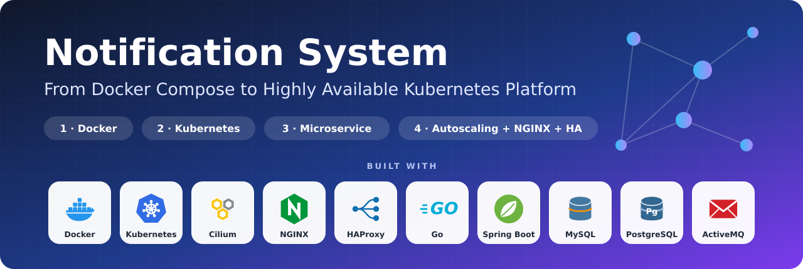
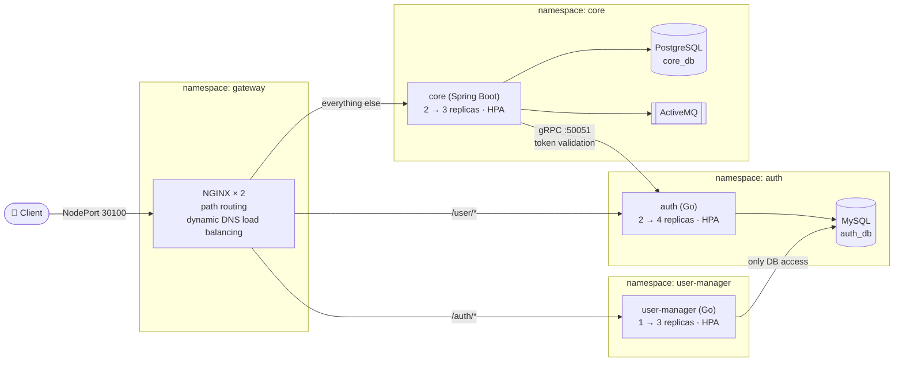
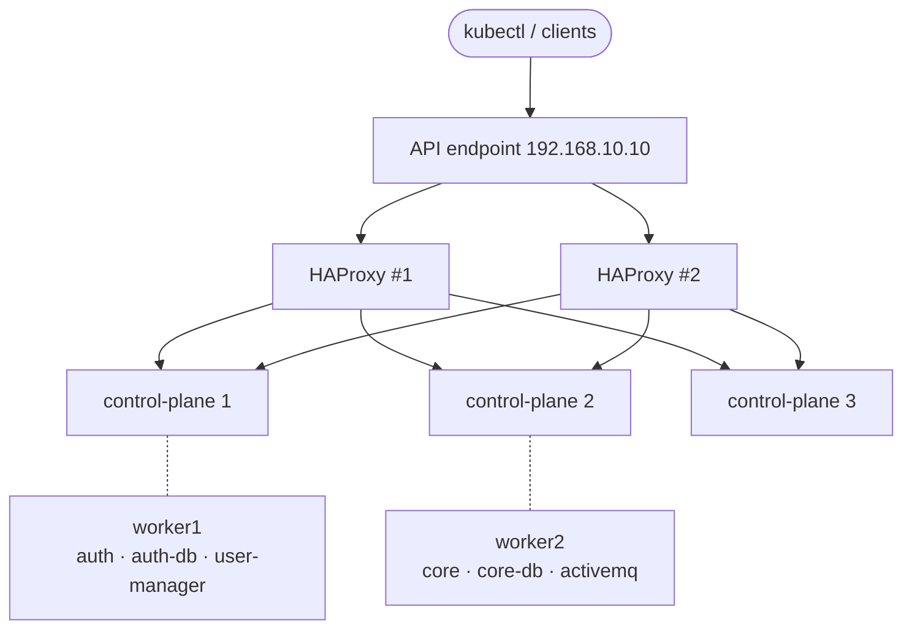

<div align="center">



<br/>


**A two-service notification platform taken from `docker compose up` all the way to an autoscaled,
network-isolated deployment on a highly available Kubernetes cluster.**

[Architecture](#architecture) ·
[Phases](#the-four-phases) ·
[Quick start](#quick-start) ·
[Docs](#documentation) ·
[Problems & fixes](docs/TROUBLESHOOTING.md) ·
[All commands](docs/COMMANDS.md)

[فارسی](README.fa.md)

</div>

---

## About

This repository is my solution to the **Cloud Computing project** at the Ferdowsi University of Mashhad (FUM).
The course supplies two ready-made microservices of a notification system. My job, as the DevOps engineer, was to
**containerise, deploy, secure, extend, scale and load-balance** them in four consecutive phases.

What makes this repo different from a plain collection of YAML files is that **every step is written down**:
what was built, why it was built that way, the commands used, how it was verified, and, just as important,
**every problem I hit and how I solved it** ([docs/TROUBLESHOOTING.md](docs/TROUBLESHOOTING.md)).

> [!NOTE]
> The course's own source code (the `auth` and `core` services) is **not** included here. This repo contains only what I
> wrote: Dockerfiles, Compose and Kubernetes manifests, the extra microservice, scripts and documentation.
> See [Quick start](#quick-start) for how to combine them with your own clones of the course repositories.

## Highlights

| | |
|---|---|
| 🐳 **Multi-stage images** | Go service on Alpine (**34 MB**), Spring Boot service on a JRE-only Alpine image (**406 MB** on disk), non-root users, secrets never baked into images |
| 🧱 **Network isolation, twice** | Per-service Docker networks in Compose, then **Cilium NetworkPolicies** in Kubernetes: default-deny, DNS allow-list, gRPC reachable *only* by the core service |
| 💾 **Persistent data** | Named volumes (Compose) and hand-made `StorageClass` + `PV` + `PVC` (Kubernetes, no provisioner available) with `Retain` policy |
| 🔐 **Config done properly** | `ConfigMap` for settings, `Secret` for every username/password/JWT key, `envFrom` wiring |
| 🧩 **A new microservice in Go** | Paginated user listing and safe deletion, JSON errors, graceful shutdown, DB-aware health check, 5 files and one dependency |
| 📈 **Autoscaling** | `metrics-server` + three HPAs with tuned scale-up/scale-down behaviour, demonstrated with a real load test |
| 🚦 **NGINX gateway** | Path-based routing and **dynamic DNS-based load balancing** over headless Services, so new Pods receive traffic within seconds |
| 🏗️ **HA control plane** | 3 control-plane nodes behind two HAProxy instances ([notes](phase4-autoscaling-gateway/ha/README.md)) |
| 📚 **Written for humans** | One document per phase, a troubleshooting log and the complete list of commands |

## Architecture



**Reading the diagram**

- Every arrow is an *allowed* network path. Everything else is blocked by NetworkPolicies, for example
  `user-manager` can talk to `auth-db` and **nothing else**, and `auth` can never reach `core-db`.
- `auth`, `core` and `user-manager` scale horizontally; the databases and the broker are single instances by design.
- gRPC between `core` and `auth` is internal-only; it is never exposed through a NodePort or through NGINX.

### The cluster underneath



Kubernetes v1.36, containerd 2.x, **Cilium** CNI. The workloads of each side of the system are pinned to a worker
with a `nodeSelector`, as the project requires.

## The four phases

| # | Phase | What was built | Deep dive |
|---|---|---|---|
| **1** | **Dockerization** | Multi-stage Dockerfiles, Compose stack with health-gated start order, per-service networks, persistent volumes, loopback-only published ports | [📖 docs/01-phase1-docker.md](docs/01-phase1-docker.md) |
| **2** | **Kubernetes** | Namespaces, ConfigMaps, Secrets, manual PV/PVC, Deployments with probes and limits, Services, NetworkPolicies | [📖 docs/02-phase2-kubernetes.md](docs/02-phase2-kubernetes.md) |
| **3** | **Own microservice** | Go REST API: paginated `GET /auth/users`, `DELETE /auth/user` by id or email, isolated in its own namespace | [📖 docs/03-phase3-microservice.md](docs/03-phase3-microservice.md) |
| **4** | **Scale & route** | metrics-server, HPAs, NGINX gateway with dynamic upstreams, headless Services, HA control plane | [📖 docs/04-phase4-autoscaling-gateway.md](docs/04-phase4-autoscaling-gateway.md) |

Start with the [project overview](docs/00-project-overview.md) to see what the two supplied services do and what each
phase demanded.

## Repository layout

```text
cloud-notification-microservice/
├── README.md · README.fa.md · LICENSE
├── assets/                      banner.svg · banner.png · social-preview.png (1280×640 for GitHub)
├── docs/                        ← the written walkthrough
│   ├── 00-project-overview.md
│   ├── 01-phase1-docker.md
│   ├── 02-phase2-kubernetes.md
│   ├── 03-phase3-microservice.md
│   ├── 04-phase4-autoscaling-gateway.md
│   ├── TROUBLESHOOTING.md       every problem hit, with cause and fix
│   └── COMMANDS.md              every command used, in order
├── phase1-docker/
│   ├── docker-compose.yml       full stack
│   ├── .env.example
│   ├── dockerfiles/{auth,core}/ Dockerfile + .dockerignore for the course services
│   └── steps/                   the intermediate "infrastructure only" compose file
├── phase2-kubernetes/
│   ├── apply.sh
│   └── k8s/ 00-namespaces · 01-storage · 10-auth · 20-core
├── phase3-microservice/
│   ├── user-manager/            Go source + Dockerfile
│   ├── apply.sh
│   └── k8s/
├── phase4-autoscaling-gateway/
│   ├── apply.sh
│   ├── k8s/ hpa · headless · gateway
│   ├── loadtest/
│   └── ha/                      HAProxy / control-plane notes
└── tools/load-image.sh          pull an image locally, import it into every worker node
```

## Quick start

### Prerequisites

| For | You need |
|---|---|
| Phase 1 | Docker Engine 24+ with the Compose plugin |
| Phases 2-4 | A Kubernetes cluster (v1.28+) with a **NetworkPolicy-enforcing CNI** such as Cilium or Calico, `kubectl`, and SSH access to the worker nodes |
| Source code | Your clones of the two course repositories: `fum-cloud-notification-auth-2025` and `fum-cloud-notification-core-2025` |

### Phase 1: run everything with Docker Compose

```bash
# 1. put the course repos next to this one and copy the Dockerfiles into them
cp phase1-docker/dockerfiles/auth/{Dockerfile,.dockerignore} ../fum-cloud-notification-auth-2025/
cp phase1-docker/dockerfiles/core/{Dockerfile,.dockerignore} ../fum-cloud-notification-core-2025/

# 2. configure and start
cd phase1-docker
cp .env.example .env            # then edit the passwords
docker compose up -d --build
docker compose ps               # wait until the three data services are "healthy"

# 3. try it
curl -i -X POST localhost:8082/user/register -H 'Content-Type: application/json' \
     -d '{"email":"a@b.com","password":"Pass1234"}'
```

### Phases 2-4: deploy to Kubernetes

```bash
# 0. build the images and put them on every worker (nodes cannot see your local Docker images)
docker build -t auth:phase1 ../fum-cloud-notification-auth-2025
docker build -t core:phase1 ../fum-cloud-notification-core-2025
docker build -t user-manager:phase3 phase3-microservice/user-manager
for img in auth:phase1 core:phase1 user-manager:phase3; do ./tools/load-image.sh "$img"; done

# 1. phase 2: namespaces, storage, config, databases, apps, network policies
./phase2-kubernetes/apply.sh

# 2. phase 3: the extra microservice
./phase3-microservice/apply.sh

# 3. phase 4: metrics-server must already work (kubectl top nodes), then:
./tools/load-image.sh docker.io/library/nginx:1.27-alpine nginx:1.27-alpine
./phase4-autoscaling-gateway/apply.sh
```

> [!IMPORTANT]
> The manifests assume two worker nodes named **`worker1`** and **`worker2`** (they are pinned with
> `kubernetes.io/hostname`) and node IPs `192.168.10.6` / `.7` in a few comments and examples. Search for those values
> and adapt them to your cluster. Every password in the manifests is an **example**; change them first.

Then use the single public entry point (the NGINX NodePort):

```bash
B=http://<any-node-ip>:30100
curl -s -X POST $B/user/login -H 'Content-Type: application/json' -d '{"email":"a@b.com","password":"Pass1234"}'
curl -s "$B/auth/users?page=1&page_size=5"
```

## Key engineering decisions

<details>
<summary><b>Why a separate namespace and NetworkPolicy set for the extra microservice?</b></summary>

The project demands the new service reaches *only* the auth database. Namespace + default-deny + a single egress rule
to `auth-db:3306` makes that a property of the cluster instead of a promise in the code. Policies are additive, so the
Phase 2 files were not touched; one extra policy in the `auth` namespace admits the new client.
</details>

<details>
<summary><b>Why does auth have two Services?</b></summary>

A NodePort Service opens *all* its ports on every node. Putting gRPC (50051) in the same Service as HTTP would have
exposed it to the whole network. One ClusterIP Service carries both ports inside the cluster; a second NodePort Service
exposes HTTP only.
</details>

<details>
<summary><b>Why headless Services and a DNS resolver in NGINX?</b></summary>

Stock NGINX resolves upstream names once, at start-up, so Pods created by the autoscaler would never get traffic.
Headless Services return the IP of every *ready* Pod, and `resolver ... valid=5s` plus `proxy_pass http://$variable`
makes NGINX re-resolve continuously and spread requests across all of them.
</details>

<details>
<summary><b>Why <code>Recreate</code> for the databases and why no <code>replicas</code> on the apps?</b></summary>

With a single-writer volume, a rolling update would briefly run two database processes on the same data directory.
`Recreate` stops the old Pod first. The app Deployments omit `replicas` because the HPA owns the count; re-applying a
manifest that pins `replicas: 1` would fight the autoscaler.
</details>

<details>
<summary><b>Why Go for the extra microservice?</b></summary>

One static binary, a 20 MB image, one dependency (the same MySQL driver version the auth service already uses) and a
build path (Go module mirrors) that was already proven to work on the restricted network used for this project.
</details>

## Verified behaviour

| Check | Result |
|---|---|
| Register → login → token validation through the stack | ✅ |
| Core accepts the token (gRPC call to auth across namespaces) | ✅ |
| Data survives container restart (Compose) and Pod deletion (Kubernetes) | ✅ same `userId` after restart |
| NetworkPolicy matrix (what each service can and cannot reach) | ✅ allowed paths open, everything else blocked |
| Image size after fixing a layer-duplication mistake | auth 55.9 MB → **34 MB**, core 556 MB → **406 MB** |
| `metrics-server`, HPAs reporting real CPU usage | ✅ |
| Scale-up under load and scale-down afterwards | ✅ auth scales between its minimum (2) and maximum (4) replicas |
| Requests spread across replicas through NGINX (`X-Served-By` header) | ✅ |

## Documentation

| Document | Contents |
|---|---|
| [00 · Project overview](docs/00-project-overview.md) | What the supplied services do, what each phase requires, findings from reading the source |
| [01 · Phase 1 · Docker](docs/01-phase1-docker.md) | Dockerfiles explained line by line, Compose design, networks, tests |
| [02 · Phase 2 · Kubernetes](docs/02-phase2-kubernetes.md) | Cluster facts, storage, config, workloads, NetworkPolicies, tests |
| [03 · Phase 3 · Microservice](docs/03-phase3-microservice.md) | API contract, code walkthrough, deployment and isolation |
| [04 · Phase 4 · Autoscaling & gateway](docs/04-phase4-autoscaling-gateway.md) | metrics-server, HPA maths, NGINX config explained, load test, HA |
| [Troubleshooting log](docs/TROUBLESHOOTING.md) | 24 problems and pitfalls, with causes and fixes |
| [Command reference](docs/COMMANDS.md) | Every command used, grouped by phase |

## Limitations and honest notes

- **`user-manager` has no authentication.** The assignment did not ask for it; anybody who can reach NodePort 30090 (or
  the gateway) can delete users. Put it behind an admin token before using anything like it for real.
- **`hostPath` volumes** tie each database to one node. Fine for a course cluster without a storage provisioner; use a
  real storage backend in production.
- **Secrets in Git** are example values only. In a real setup use sealed secrets, SOPS or an external secret store.
- **gRPC is not balanced by NGINX.** The long-lived gRPC channel from `core` sticks to one `auth` Pod per core replica.
- **HAProxy / control-plane configuration** is described in [phase4-autoscaling-gateway/ha](phase4-autoscaling-gateway/ha/README.md);
  the actual `haproxy.cfg` still has to be added there.

## Author

**Ali Kashki**, DevOps / SRE · [github.com/alikashki](https://github.com/alikashki)

Released under the [MIT License](LICENSE).

<sub>The technology marks in the banner are simplified drawings made for this project. All product names and trademarks belong to their respective owners.</sub>
