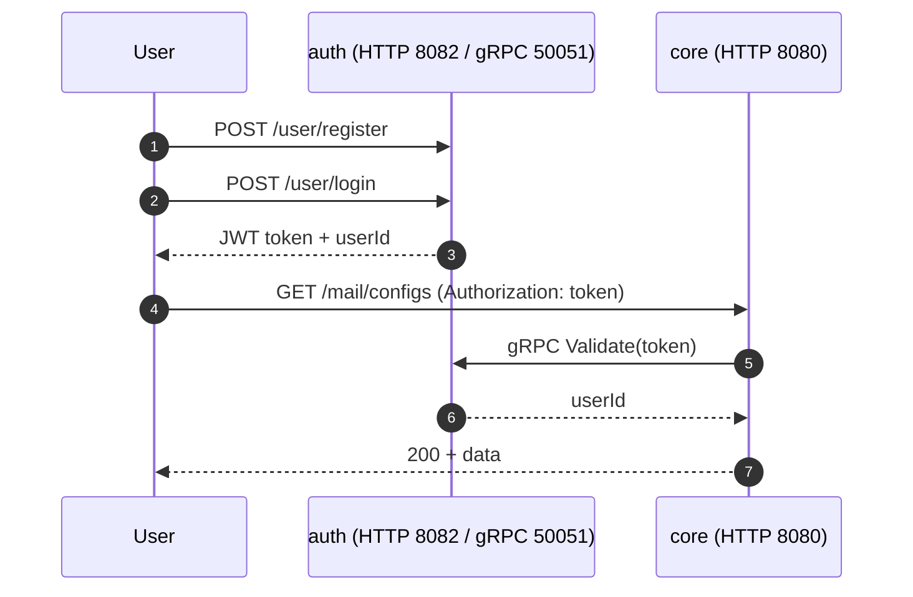

# 00 · Project overview

> What the course project asks for, what the two supplied services really do, and what I learned by reading their
> source code **before** writing a single Dockerfile.

[← back to README](../README.md) · next: [Phase 1 · Docker →](01-phase1-docker.md)

---

## 1. The system

The course supplies a *notification management system* made of two microservices. Users register, log in, and
configure and send e-mail notifications (e-mail is the only channel).

| | **Auth service** | **Core service** |
|---|---|---|
| Language / framework | Go (Gin, GORM) | Java 17, Spring Boot 2.7.5, Maven |
| Responsibility | Registration, login (JWT), token validation | Notification settings and sending |
| Database | **MySQL** (`users` table) | **PostgreSQL** |
| Other dependencies | none | **ActiveMQ** (message queue) |
| HTTP port | `8082` (hard-coded) | `8080` (Swagger UI at `/docs`) |
| gRPC | server on `50051` | client of the auth gRPC server |

## 2. The four phases

| Phase | Title | Required outcome | Video |
|---|---|---|---|
| 1 | **Dockerization** | Dockerfiles + Compose; per-service networks; 50051 not exposed; each service sees only its own DB; persistent DBs; only necessary ports published | ≤ 8 min |
| 2 | **Kubernetes** | ≥ 3 nodes; Deployments/Services; one namespace per service+DB; ConfigMaps; Secrets; DB reachable only in-cluster; PV/PVC; resource limits; each Deployment on a dedicated node; Docker-phase networking preserved; **not** one big YAML | ≤ 8 min |
| 3 | **Add your own microservice** | REST API: paginated `GET /auth/users`, `DELETE /auth/user` (id or email, handle exceptions); JSON; reaches the auth DB in a separate network and *nothing else*; exposed outside the cluster | ≤ 5 min |
| 4 | **Autoscaling, HA, load balancing** | HPA that scales up under load and down afterwards (no DB scaling); internal NGINX with custom routing; **two** control-plane nodes behind an external HAProxy | ≤ 10 min |

## 3. Reading the source first (Step 0)

Before writing anything I unpacked both repositories and read the configuration and the code paths that matter for
deployment. This paid for itself many times over; most of the later design decisions come straight from these findings.

### Auth service (Go)

| Finding | Consequence for the deployment |
|---|---|
| The code opens the database with `gorm.io/driver/mysql`, so the database is **MySQL**. The sample `envs/dev.env` and `docker-compose.yml` in the repo still contain **PostgreSQL** placeholders (leftovers). | Auth gets a MySQL container and a MySQL-style DSN: `user:pass@tcp(host:3306)/db?charset=utf8mb4&parseTime=True&loc=Local`. Using the sample Postgres URL would crash it. |
| HTTP port `:8082` is hard-coded in `main.go`; the **gRPC** port comes from the `PORT` env var (value must include the colon: `:50051`). | HTTP port cannot be changed by config; Services/policies use 8082 as a constant. |
| Config is read by viper from `./envs/dev.env` (the file **must exist**), with `AutomaticEnv()` on. Only keys that are present in that file can be overridden by environment variables. | The image ships a placeholder `dev.env` with *empty* values for `PORT`, `DB_URL`, `JWT_SECRET_KEY`, and real values are injected as env vars. |
| `db.Init` calls `log.Fatalln` when the database is unreachable, then `AutoMigrate(&User{})`. | The container exits if the DB is not ready → health-gated start order (Compose) / init container (Kubernetes). |
| The model is `User{Id, Email, Password}` with no soft-delete → table `users`, columns `id`, `email`, `password`. | The Phase 3 service can use plain SQL against `users`. |
| `POST /user/validate` strips the `Bearer ` prefix itself, but the gRPC `Validate` method expects the **raw token**. | See the core service below: it forwards the raw header value. |
| Small bugs (panic on a very short `Authorization` header, double JSON write on error, DSN printed with password in the log). | Documented; not changed. |

### Core service (Spring Boot)

| Finding | Consequence |
|---|---|
| The datasource and ActiveMQ settings are already `${ENV_VAR:default}` placeholders. | Configured entirely through environment variables (`PROJECT_DATASOURCE_*`, `ACTIVEMQ_*`). |
| `auth.grpc.address`, `auth.grpc.port` and `auth.service.base.url` are hard-coded, **but** Spring Boot's relaxed binding lets `AUTH_GRPC_ADDRESS` etc. override them. | No code or profile changes needed. |
| Only the gRPC client is used; the HTTP base URL is dead configuration (Retrofit classes are imported but unused). | Core needs the **gRPC** path to auth, not the HTTP port. |
| The security filter validates the token via gRPC for **every** request except URLs containing `swagger`, `docs` or `webhook`, and it forwards the `Authorization` header **as is**. | Send the raw token (no `Bearer`) to Core. `/actuator/health` also needs a token, so it cannot be used for Kubernetes probes; `/docs` can. |
| The protobuf Maven plugin downloads `protoc` and `protoc-gen-grpc-java` (glibc binaries) during the build. | The Maven build stage must be Debian/Ubuntu based, **not Alpine**. |
| The build produces `target/fum-cloud-notification-core-0.0.1-SNAPSHOT.jar`; Hikari fails the start-up if PostgreSQL is down. | Fixed jar name in the Dockerfile; wait for the DB before starting. |

## 4. My environment

| | |
|---|---|
| Phase 1 | Docker on a Debian 13 host |
| Phases 2-4 | An existing kubeadm cluster: **3 control-plane + 2 worker nodes**, Kubernetes v1.36.3, containerd 2.3.3, **Cilium** CNI, **no StorageClass**, no metrics-server at the start; 2 HAProxy instances in front of the API endpoint |
| Network | Restricted internet (Docker Hub, `proxy.golang.org`, `registry.k8s.io` are not reliably reachable). Mirrors are used for images and Go modules; see [TROUBLESHOOTING](TROUBLESHOOTING.md) |

I first planned to use **Kind** (the course's preferred tool) and wrote a config for it, then switched when it turned out
a real cluster was available. The assignment explicitly allows alternatives. That detour is the reason the log in
[TROUBLESHOOTING](TROUBLESHOOTING.md) has an entry about it: **ask about the environment before designing for one.**

## 5. How this repository is organised

Each phase has its own folder with runnable files and a matching document that explains every step:

| Folder | Document |
|---|---|
| [`phase1-docker/`](../phase1-docker) | [01 · Phase 1](01-phase1-docker.md) |
| [`phase2-kubernetes/`](../phase2-kubernetes) | [02 · Phase 2](02-phase2-kubernetes.md) |
| [`phase3-microservice/`](../phase3-microservice) | [03 · Phase 3](03-phase3-microservice.md) |
| [`phase4-autoscaling-gateway/`](../phase4-autoscaling-gateway) | [04 · Phase 4](04-phase4-autoscaling-gateway.md) |

[← back to README](../README.md) · next: [Phase 1 · Docker →](01-phase1-docker.md)
