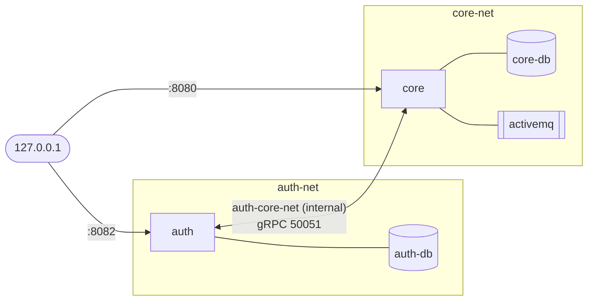

# 01 · Phase 1 · Dockerization

> Containerise both services, run them together with Docker Compose, isolate them on separate networks and keep the
> databases persistent.

[← overview](00-project-overview.md) · [README](../README.md) · next: [Phase 2 · Kubernetes →](02-phase2-kubernetes.md)

**Files:** [`phase1-docker/`](../phase1-docker) · **Result:** 5 containers, 3 networks, 3 volumes, 2 published ports.

---

## Requirements → solution

| Requirement from the assignment | How it is met |
|---|---|
| Use the suggested images (PostgreSQL 13.13, `webcenter/activemq`, MySQL, Go/Alpine, Maven+JDK17) | Same images; build stages use Go-Alpine and Maven+JDK 17 |
| Multi-stage Dockerfiles (smaller images) | Both services: build stage + minimal runtime stage |
| Databases created and configured before the services; **persistent** | `healthcheck` + `depends_on: service_healthy`; named volumes |
| Configure `URL_DB`, datasource, ActiveMQ and auth connection parameters | Environment variables built from a `.env` file |
| Each microservice in **its own Docker network** | `auth-net`, `core-net`, plus a dedicated `auth-core-net` |
| Port **50051 reachable only by core**, never exposed | Only on the internal `auth-core-net`, never in `ports:` |
| Each service reaches **only its own DB** | DBs live on their service's network only |
| Restrict external access, expose only necessary ports | Only HTTP 8082 and 8080, bound to `127.0.0.1`; DBs/ActiveMQ publish nothing |

## Step 1.1 · Auth Dockerfile

[`dockerfiles/auth/Dockerfile`](../phase1-docker/dockerfiles/auth/Dockerfile)

```dockerfile
FROM golang:1.22-alpine AS build
ARG GOPROXY=https://mirror.abrha.net/repository/go/|https://mirror-go.runflare.com|...|direct
ARG GOSUMDB=off
WORKDIR /src
COPY go.mod go.sum ./
RUN go mod download                     # cached until go.mod/go.sum change
COPY . .
RUN CGO_ENABLED=0 GOOS=linux go build -trimpath -ldflags="-s -w" -o /out/auth ./cmd/main.go

FROM alpine:3.20
RUN addgroup -S app && adduser -S -G app app
WORKDIR /app
COPY --from=build /out/auth ./auth
RUN mkdir -p envs && printf 'PORT=:50051\nDB_URL=\nJWT_SECRET_KEY=\n' > envs/dev.env
USER app
EXPOSE 8082 50051
ENTRYPOINT ["./auth"]
```

| Line | Why |
|---|---|
| Two stages | The Go toolchain (~300 MB) stays in the build stage; the final image is Alpine plus one binary |
| `COPY go.mod go.sum` **before** `COPY . .` | Layer caching: re-downloading modules happens only when dependencies change |
| `CGO_ENABLED=0` | A fully static binary (the MySQL driver is pure Go), runs on Alpine's musl libc |
| `-trimpath -ldflags="-s -w"` | Smaller binary, no build-machine paths or debug symbols |
| `GOPROXY=a\|b\|c\|direct` | `proxy.golang.org` returns **403** from the restricted network. `\|` makes Go try the next mirror on *any* error; `,` only continues on 404/410 ([details](TROUBLESHOOTING.md#2-go-mod-download-fails-with-403-forbidden)) |
| Placeholder `envs/dev.env` | The app *requires* the file and only overrides keys that exist in it ([finding](00-project-overview.md#auth-service-go)); the repo's own file holds a secret, so an empty template is generated instead |
| `USER app` | Never run as root |
| `ENTRYPOINT ["./auth"]` (exec form) | The process is PID 1 and receives `SIGTERM` from `docker stop` |

## Step 1.2 · Core Dockerfile

[`dockerfiles/core/Dockerfile`](../phase1-docker/dockerfiles/core/Dockerfile)

```dockerfile
FROM maven:3.6.3-openjdk-17 AS build
WORKDIR /build
COPY pom.xml .
COPY src ./src
RUN --mount=type=cache,target=/root/.m2 mvn -B clean package -DskipTests

FROM eclipse-temurin:17-jre-alpine
RUN addgroup -S app && adduser -S -G app app
WORKDIR /app
COPY --from=build /build/target/fum-cloud-notification-core-0.0.1-SNAPSHOT.jar ./app.jar
USER app
ENV JAVA_OPTS="-XX:MaxRAMPercentage=75.0"
EXPOSE 8080
ENTRYPOINT ["sh", "-c", "exec java $JAVA_OPTS -jar app.jar"]
```

| Line | Why |
|---|---|
| Build stage on **Debian**, not Alpine | The protobuf Maven plugin downloads glibc `protoc` binaries that cannot run on musl/Alpine |
| `--mount=type=cache,target=/root/.m2` | BuildKit keeps the Maven repository between builds; it never enters the image |
| Runtime = **JRE only** | No compiler or Maven in the final image |
| `-XX:MaxRAMPercentage=75` | The JVM sizes its heap from the *container memory limit*, which matters once Kubernetes limits are set |
| `sh -c "exec java ..."` | Needed so `$JAVA_OPTS` is expanded; `exec` makes `java` PID 1 again |
| No `RUN chown` after `COPY` | See the [size lesson](#size-lesson-a-chown-doubled-the-image) below |

Both directories also get a [`.dockerignore`](../phase1-docker/dockerfiles/auth/.dockerignore) (the Windows `main.exe`
shipped in the Auth repo, `target/`, `.git`, env files).

### Size lesson: a `chown` doubled the image

My first versions ended with `RUN chown app:app app.jar` (and `chown -R app:app /app` for Auth). Every Docker layer is
immutable, so changing ownership of a file *copies the whole file into a new layer*, and the original stays in the
image underneath.

| Image | Before | After removing the `chown` |
|---|---|---|
| `auth` | 55.9 MB | **34 MB** |
| `core` | 556 MB | **406 MB** |

The user only needs to *read* and *execute* the files, and they are world-readable by default, so no `chown` was
necessary at all. (`COPY --chown=...` is the correct way when ownership really matters.)

## Step 1.3 · Databases and ActiveMQ first

The assignment says the databases must exist and be configured before the services start. I therefore built and
tested the infrastructure **alone** first ([`steps/docker-compose.step1.3-infra-only.yml`](../phase1-docker/steps/docker-compose.step1.3-infra-only.yml)),
which also isolates problems: if something fails later, it is not the databases.

| Service | Image | Persistence | Health check |
|---|---|---|---|
| `auth-db` | `mysql:latest` | volume `auth-db-data` → `/var/lib/mysql` | `mysqladmin ping -h 127.0.0.1` |
| `core-db` | `postgres:13.13-bullseye` | volume `core-db-data` → `/var/lib/postgresql/data` | `pg_isready -h 127.0.0.1` |
| `activemq` | `webcenter/activemq` | volume `activemq-data` → `/data` | TCP connect to 61616 |

Details that matter:

- **`-h 127.0.0.1` in the health checks.** During first-time initialisation both databases run a *temporary* server
  that listens on the unix socket only. Without `-h 127.0.0.1` the check passes against that temporary server and the
  dependent service starts too early.
- **`$$VAR` instead of `${VAR}`** in the check commands: `$$` is evaluated *inside the container* from its own
  environment, so the password is not substituted into the Compose model (and not visible in `docker inspect`).
- **No `ports:`** on any of the three: nothing outside Docker can reach them.

## Step 1.4 · Add the two services

[`docker-compose.yml`](../phase1-docker/docker-compose.yml)

| Variable group | Service | Values |
|---|---|---|
| `PORT`, `DB_URL`, `JWT_SECRET_KEY` | auth | `PORT=":50051"`; DSN built from the DB variables: `user:pass@tcp(auth-db:3306)/db?charset=utf8mb4&parseTime=True&loc=Local` |
| `PROJECT_DATASOURCE_JDBC_URL / USERNAME / PASS / SCHEMA` | core | `jdbc:postgresql://core-db:5432/<db>` … |
| `ACTIVEMQ_URL / USERNAME / PASSWORD` | core | `failover:(tcp://activemq:61616)?randomize=true&...` |
| `AUTH_GRPC_ADDRESS`, `AUTH_GRPC_PORT`, `AUTH_SERVICE_BASE_URL` | core | `auth`, `50051`, `http://auth:8082/` |

`depends_on` with `condition: service_healthy` starts Auth after MySQL, and Core after PostgreSQL **and** ActiveMQ.
Auth is only `service_started` for Core, because the gRPC channel connects lazily.

## Step 1.5 · Network design



- `auth-core-net` is declared **`internal: true`**: no gateway, no route to the host or the internet, and it contains
  *only* `auth` and `core`. It is the single path for gRPC, and 50051 is never listed under `ports:`.
- A container only resolves the names of containers that share a network with it, so `auth` cannot even *find*
  `core-db`, and `core` cannot find `auth-db`.
- Published ports are bound to **`127.0.0.1`** (`127.0.0.1:8082:8082`). Without that prefix Docker publishes on
  `0.0.0.0` and the whole LAN can reach the service.

> [!TIP]
> A subtle Compose rule: a container can only *publish* a port if it is attached to at least one **non-internal**
> network. That is why `auth-net` and `core-net` are normal networks and only the gRPC link is `internal`. A draft I
> reviewed made every network internal and its Auth HTTP port silently became unreachable.

## Step 1.6 · Verification

```bash
docker compose config > /dev/null && echo OK       # validate and interpolate .env
docker compose up -d --build
docker compose ps

# functionality
curl -i -X POST localhost:8082/user/register -H 'Content-Type: application/json' -d '{"email":"a@b.com","password":"Pass1234"}'
curl -s -X POST localhost:8082/user/login    -H 'Content-Type: application/json' -d '{"email":"a@b.com","password":"Pass1234"}'
curl -sI localhost:8080/docs | head -1             # 302 → Swagger UI
```

| Check | How | Expected |
|---|---|---|
| Auth + DB + JWT | register, login | `200` and a token with `userId` |
| gRPC core → auth | `curl localhost:8080/mail/configs -H "Authorization: $TOKEN"` | `200` |
| Token header format | same call with `Bearer $TOKEN` | `401` (Core wants the raw token; see [overview](00-project-overview.md#core-service-spring-boot)) |
| Reachability matrix | `docker compose exec auth sh -c 'nc -z -w 3 HOST PORT'` for each pair | auth reaches `auth-db`, `core:8080`; **not** `core-db`, `activemq`. core reaches `core-db`, `activemq`, `auth:50051`, `auth:8082`; **not** `auth-db` |
| Published ports | `docker compose ps --format 'table {{.Name}}\t{{.Ports}}'` | only `127.0.0.1:8082->8082` and `127.0.0.1:8080->8080`; 50051 and DB ports unpublished |
| Persistence | `docker compose down` (**without** `-v`) → `up -d` → log in again | same `userId` |

> [!WARNING]
> `docker compose down -v` deletes the volumes and therefore all data.

## What I would do differently

- Pin `mysql:latest` to a major version; `latest` moved to MySQL 9 during the project.
- Add a health check to the `auth` service (it has no health endpoint, a TCP check would do).

[← overview](00-project-overview.md) · [README](../README.md) · next: [Phase 2 · Kubernetes →](02-phase2-kubernetes.md)
