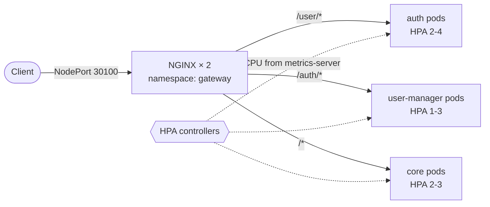

# 04 · Phase 4 · Autoscaling, NGINX gateway and a highly available control plane

> Let the services scale themselves, put an NGINX gateway with custom routing in front of them, and make the cluster's
> API endpoint survive the loss of a control-plane node or a load balancer.

[← Phase 3](03-phase3-microservice.md) · [README](../README.md) · next: [Troubleshooting log →](TROUBLESHOOTING.md)

**Files:** [`phase4-autoscaling-gateway/`](../phase4-autoscaling-gateway) · **Apply:** [`apply.sh`](../phase4-autoscaling-gateway/apply.sh)

---

## Requirements → solution

| Requirement | Solution |
|---|---|
| Services scale **up** under load and **down** afterwards (databases excluded) | `metrics-server` + three `HorizontalPodAutoscaler`s |
| **Internal NGINX** with custom routing that spreads requests evenly over the replicas | NGINX Deployment in namespace `gateway`, path-based routing, **dynamic DNS upstreams** over headless Services |
| More master nodes (two) behind an **external HAProxy** | The cluster already has 3 control-plane nodes behind 2 HAProxy instances ([notes](../phase4-autoscaling-gateway/ha/README.md)) |



---

## Step 4.1 · metrics-server

An HPA needs a metrics API. Without it every HPA shows `<unknown>` and `kubectl top` says *Metrics API not available*.

```bash
kubectl apply -f https://github.com/kubernetes-sigs/metrics-server/releases/latest/download/components.yaml
```

Two things went wrong on the restricted network; both are in [Troubleshooting](TROUBLESHOOTING.md):

1. **The image could not be pulled** from `registry.k8s.io` (#12). Fix: pull it directly on every node:
   `ctr -n k8s.io image pull registry.k8s.io/metrics-server/metrics-server:<tag>` (or use `tools/load-image.sh`).
2. **`x509: cannot validate certificate`** when scraping the kubelets (#13). The kubelet serving certificates of a
   kubeadm cluster are self-signed. Fix:

```bash
kubectl patch deployment metrics-server -n kube-system --type=json -p='[
  {"op":"add","path":"/spec/template/spec/containers/0/args/-","value":"--kubelet-insecure-tls"}
]'
kubectl rollout status deploy/metrics-server -n kube-system
kubectl top nodes
```

<details>
<summary><b>Anatomy of that <code>kubectl patch</code> command</b></summary>

| Part | Meaning |
|---|---|
| `--type=json` | an RFC 6902 patch: a list of operations. `merge`/`strategic` would **replace** the whole `args` array and delete the existing flags |
| `"op":"add"` | insert a value (other ops: `remove`, `replace`, `move`, `copy`, `test`) |
| `/spec/template/spec/containers/0/args/-` | JSON Pointer: Deployment → Pod template → first container → `args` → `-` = *append at the end* |
| `--kubelet-insecure-tls` | metrics-server skips verifying the kubelet's certificate |

Patching `spec.template` changes the Pod template, so Kubernetes performs a rolling update. For production the proper
fix is `serverTLSBootstrap: true` in the kubelet config plus approving the CSRs.
</details>

Result:

```text
NAME      CPU(cores)   CPU(%)   MEMORY(bytes)   MEMORY(%)
cp1       174m         8%       1769Mi          62%
worker1   49m          2%       985Mi           53%
worker2   43m          2%       1007Mi          54%
...
```

## Step 4.2 · Horizontal Pod Autoscalers

[`k8s/hpa/`](../phase4-autoscaling-gateway/k8s/hpa)

```yaml
spec:
  scaleTargetRef: { apiVersion: apps/v1, kind: Deployment, name: auth }
  minReplicas: 2
  maxReplicas: 4
  metrics:
    - type: Resource
      resource: { name: cpu, target: { type: Utilization, averageUtilization: 60 } }
  behavior:
    scaleUp:   { stabilizationWindowSeconds: 0,  policies: [{ type: Pods, value: 2, periodSeconds: 30 }] }
    scaleDown: { stabilizationWindowSeconds: 60, policies: [{ type: Pods, value: 1, periodSeconds: 30 }] }
```

| Service | min | max | CPU target |
|---|---|---|---|
| `auth` | 2 | 4 | 60 % |
| `core` | 2 | 3 | 60 % |
| `user-manager` | 1 | 3 | 60 % |

**How the HPA decides**

```text
desired replicas = ceil( current replicas × current average CPU ÷ target )
```

"CPU" means usage as a percentage of each Pod's CPU **request**, not its limit. `auth` requests 50m, so at a 60 % target
it adds Pods once the average exceeds ~30m per Pod. This is why the `requests` set in Phase 2 matter.

- **`minReplicas: 2`** for `auth` and `core` is deliberate: with one replica there would be nothing for the gateway to
  balance.
- **`scaleUp`** reacts immediately (at most +2 Pods every 30 s); **`scaleDown`** waits 60 s of low load and then removes
  one Pod per 30 s. Kubernetes' default scale-down delay is 5 minutes, too slow to demonstrate.
- **The app Deployments no longer set `spec.replicas`.** The HPA owns the number; re-applying a manifest that pins
  `replicas: 1` would reset the scale on every `kubectl apply` ([Troubleshooting #16](TROUBLESHOOTING.md#16-hpa-and-the-replicas-field-fight)).

```bash
kubectl apply -f phase4-autoscaling-gateway/k8s/hpa/
kubectl get hpa -A
```
```text
NAMESPACE      NAME           REFERENCE                 TARGETS       MINPODS   MAXPODS   REPLICAS
auth           auth           Deployment/auth           cpu: 2%/60%   2         4         2
core           core           Deployment/core           cpu: 2%/60%   2         3         2
user-manager   user-manager   Deployment/user-manager   cpu: 4%/60%   1         3         1
```

### Capacity check before scaling

`kubectl describe node worker1 worker2 | grep -A8 "Allocated resources"` showed:

| Node | Memory (allocatable ≈) | `requests` | Free for the scheduler |
|---|---|---|---|
| worker1 | 1.8 GiB | 818 Mi (44 %) | ≈ 1 GiB |
| worker2 | 1.8 GiB | 1290 Mi (70 %) | ≈ 550 Mi |

worker1 can hold `auth` and `user-manager` at their maximum. **worker2 cannot hold `core` at 3 replicas**: each replica
requests 512 Mi, and real JVM usage plus ActiveMQ's heap would exceed physical memory. Recommendation: **4 GiB RAM** on
worker2 (and ideally worker1). Until then the 2nd/3rd `core` replica may stay `Pending`; that is a capacity signal, not
a manifest error.

## Step 4.3 · The NGINX gateway

[`k8s/gateway/`](../phase4-autoscaling-gateway/k8s/gateway) and [`k8s/headless/`](../phase4-autoscaling-gateway/k8s/headless)

### Routing

| Path | Backend | Port |
|---|---|---|
| `/user/*` | auth | 8082 |
| `/auth/*` | user-manager | 8090 |
| `/nginx-health` | answered by NGINX itself (readiness probe) | |
| everything else (`/mail/*`, `/docs`, ...) | core | 8080 |

One public port instead of three: **NodePort 30100**. Two NGINX replicas with a *preferred* anti-affinity so they land
on different nodes.

### The interesting part: balancing across Pods that come and go

Stock NGINX resolves upstream names **once at start-up**. Pods that the HPA creates later would never get traffic. Three
pieces fix that:

1. **Headless Services** (`clusterIP: None`): DNS for `auth-headless.auth.svc.cluster.local` returns the IP of every
   **ready** Pod, so NGINX sees real replicas, and Pods that are starting or terminating are excluded.
2. **`resolver kube-dns.kube-system.svc.cluster.local valid=5s`**: NGINX asks cluster DNS again every 5 seconds.
3. **`set $backend "..."; proxy_pass http://$backend;`**: using a *variable* in `proxy_pass` is what makes NGINX use the
   resolver at request time. With several addresses it picks among them (the resolver rotates the cached list), so load
   spreads across all replicas. Because no URI follows the variable, the original request path is passed through
   unchanged.

```nginx
resolver kube-dns.kube-system.svc.cluster.local valid=5s ipv6=off;

location /user/ {
    set $backend "auth-headless.auth.svc.cluster.local:8082";
    add_header X-Served-By $upstream_addr always;      # which Pod answered
    proxy_pass http://$backend;
}
```

`proxy_next_upstream error timeout` retries a request on another replica if the first refuses the connection; the
`gateway` access log prints `upstream=<pod-ip>:<port>` for every request.

NetworkPolicy for the gateway: default-deny, DNS, **ingress 8080 from anywhere**, **egress only** to the three backends
on their own HTTP ports.

```bash
./tools/load-image.sh docker.arvancloud.ir/library/nginx:1.27-alpine nginx:1.27-alpine    # nodes cannot pull it themselves
./phase4-autoscaling-gateway/apply.sh
kubectl get pods,svc -n gateway -o wide
kubectl get endpoints -n auth auth-headless                  # one IP per ready auth Pod
```

### Is the load really balanced?

```bash
B=http://192.168.10.6:30100
for i in $(seq 1 12); do
  curl -s -o /dev/null -D - -X POST $B/user/login -H 'Content-Type: application/json' \
       -d '{"email":"a@b.com","password":"Pass1234"}' | grep -i x-served-by
done | sort | uniq -c
```

Expected: as many different Pod IPs as there are ready `auth` replicas, with similar counts.

## Step 4.4 · Load test

`POST /user/login` hashes the password with bcrypt, which is CPU-heavy, so a few parallel loops are enough to push `auth`
past its 60 % target. [`loadtest/loadgen-auth.yaml`](../phase4-autoscaling-gateway/loadtest/loadgen-auth.yaml) runs 6
loops *inside* the cluster against the gateway (it reuses the auth image only because it contains BusyBox `wget`).

```bash
# terminal 1: watch
watch -n 3 'kubectl get hpa -A; echo; kubectl get pods -n auth -o wide; echo; kubectl top pods -n auth'

# terminal 2: generate load
kubectl apply -f phase4-autoscaling-gateway/loadtest/loadgen-auth.yaml
```

What you should see, in order: CPU % climbs far above 60 % → replicas 2 → 4 in steps of two every 30 s → new Pods become
`1/1` → the `X-Served-By` loop above now shows four IPs.

Stop the load and watch it shrink:

```bash
kubectl delete -f phase4-autoscaling-gateway/loadtest/loadgen-auth.yaml
```

After the 60 s stabilisation window the HPA removes one Pod per 30 s until `auth` is back at 2.

Scaling `core` the same way needs a token (every request is validated through gRPC):

```bash
TOKEN=$(curl -s -X POST http://192.168.10.6:30100/user/login -H 'Content-Type: application/json' \
  -d '{"email":"a@b.com","password":"Pass1234"}' | sed -E 's/.*"token":"([^"]+)".*/\1/')
kubectl create deployment loadgen-core --image=auth:phase1 --replicas=8 -- sh -c \
  "while true; do wget -q -O /dev/null --header 'Authorization: $TOKEN' http://nginx.gateway.svc.cluster.local/mail/configs || sleep 1; done"
kubectl delete deployment loadgen-core          # when done
```

## Step 4.5 · High availability of the control plane

The cluster has **three control-plane nodes** (a stacked etcd member on each) and **two HAProxy** instances in front of
the API endpoint `192.168.10.10`. The assignment asks for two masters and an external HAProxy; three is the
better-practice number (etcd needs a majority) and satisfies the intent.

The configuration and failover evidence are documented in
[`phase4-autoscaling-gateway/ha/README.md`](../phase4-autoscaling-gateway/ha/README.md).

## Results

| Check | Result |
|---|---|
| `kubectl top nodes` | ✅ metrics for all 5 nodes |
| HPAs show real CPU values | ✅ |
| Scale up under load, scale down after it | ✅ |
| Requests distributed across replicas (`X-Served-By`) | ✅ |
| Routing `/user/*`, `/auth/*`, `/*` through one port | ✅ |

## Limitations and next steps

- **gRPC (core → auth) bypasses NGINX.** A gRPC channel is one long-lived HTTP/2 connection, so each `core` replica
  sticks to one `auth` Pod. NGINX could proxy it with `grpc_pass`; not done here.
- The old NodePorts (30082, 30080, 30090) still bypass the gateway. Converting those Services to `ClusterIP` and
  tightening the ingress policies to the `gateway` namespace would make NGINX the only entry point.
- Add a `PodDisruptionBudget` and spread replicas across nodes (`topologySpreadConstraints`) for real availability; the
  assignment's "one Deployment per dedicated node" rule keeps replicas of a service on one node here.

[← Phase 3](03-phase3-microservice.md) · [README](../README.md) · next: [Troubleshooting log →](TROUBLESHOOTING.md)
