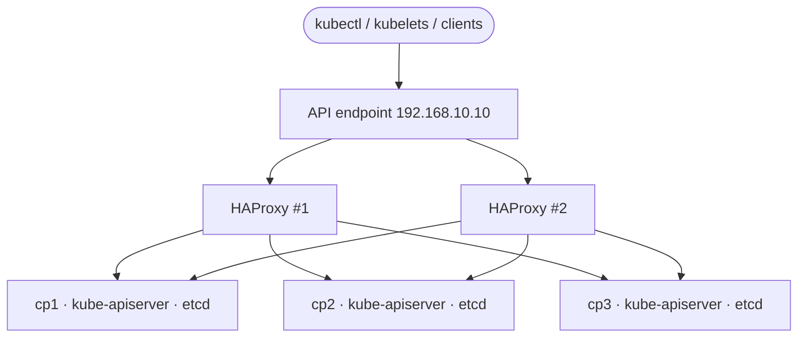

# High-availability control plane: HAProxy + 3 control-plane nodes

> [!NOTE]
> **To be completed by the author.** The cluster used for this project already has this topology, but the actual
> HAProxy / keepalived configuration files were not part of the working session, so they are intentionally **not**
> invented here. Add your real files and fill in the sections below.

## Topology (as built)



- 3 control-plane nodes: `cp1`, `cp2`, `cp3` (192.168.10.1-3)
- 2 HAProxy instances providing the Kubernetes API endpoint `192.168.10.10`
- 2 workers: `worker1`, `worker2`

The assignment says "increase the master nodes to two and use an external HAProxy". Three control-plane nodes
satisfy the intent (an odd number keeps an etcd majority when one node is lost). Confirm with your instructor that
three is acceptable.

## TODO: add the real configuration

Collect it on each HAProxy machine (remove anything sensitive first):

```bash
cat /etc/haproxy/haproxy.cfg
systemctl status haproxy --no-pager | head -8
cat /etc/keepalived/keepalived.conf 2>/dev/null          # if the endpoint IP floats with keepalived
systemctl status keepalived --no-pager 2>/dev/null | head -8
ip -4 addr show | grep inet
```

and save the files here as `haproxy.cfg` (and `keepalived.conf`). Then document:

| Topic | What to write |
|---|---|
| Frontend | bind address/port, mode (`tcp` for the API server) |
| Backend | the three control-plane servers, balancing algorithm, health checks |
| Endpoint failover | how `192.168.10.10` moves between the two HAProxy nodes |
| kubeconfig | `server: https://192.168.10.10:6443` |

## TODO: failover evidence

Run one test at a time and restore the component afterwards.

```bash
kubectl get nodes                       # works through the endpoint
# 1. stop HAProxy on ONE load balancer, re-run kubectl get nodes (should still work), start it again
# 2. take ONE control-plane node out of service, re-run kubectl get nodes, bring it back
```

Record the outputs (or a screenshot) in `docs/images/` and link them here.
